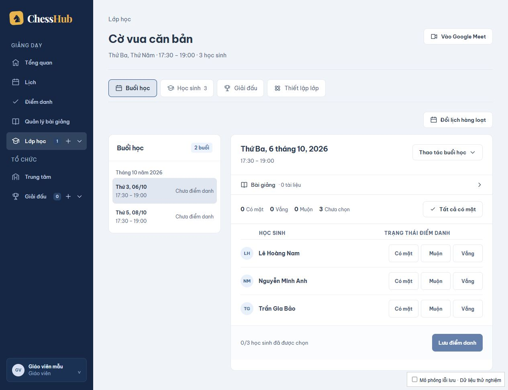
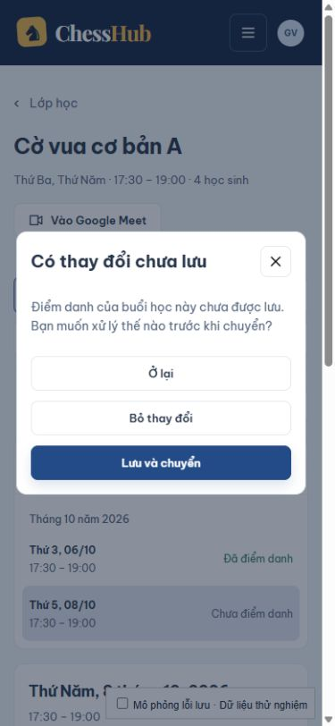

# ChessHub — triển khai hướng A

Phạm vi người dùng đã chọn: Lịch mở buổi học trong workspace lớp; triển khai workspace lớp, bảo vệ dữ liệu chưa lưu và làm rõ nút thao tác trước. Giữ nhận diện navy/gold và dựng trực tiếp bằng code.

## Kết quả

| Nơi làm việc | Trách nhiệm |
| --- | --- |
| Lịch | Xem/lọc lịch; nút **Mở buổi học** tới đúng lớp, đúng buổi |
| Lớp → Buổi học | Chọn buổi, điểm danh, gắn bài giảng, sửa một buổi hoặc đổi lịch hàng loạt có xem trước |
| Lớp → Học sinh | Danh sách, liên hệ phụ huynh, thêm học sinh ngay trong danh sách, gỡ khỏi lớp |
| Lớp → Giải đấu | Danh sách giải của lớp, nút **Mở giải** và **Tạo giải** |
| Lớp → Thiết lập lớp | Sửa tên và học phí, cập nhật tiêu đề và sidebar sau lưu |

Đã bỏ màn `ClassManagementPage` riêng. Các liên kết `/classes/:id/manage?section=...` cũ chuyển sang workspace với đúng biểu mẫu. Việc chọn buổi cập nhật URL; Back/Forward và liên kết từ Lịch giữ đúng ngữ cảnh buổi học.

Điểm danh, hồ sơ học sinh, thông tin lớp và lịch đang chỉnh có bảo vệ khi điều hướng. Hộp thoại cho phép ở lại hoặc bỏ thay đổi; điểm danh và biểu mẫu còn có **Lưu và chuyển**. Lưu thất bại giữ bản nháp và không chuyển trang. Lịch hàng loạt vẫn phải xem trước và xác nhận trong trình chỉnh lịch. Cảnh báo tải lại/đóng trang dùng cơ chế `beforeunload` của trình duyệt; đây không phải lưu bản nháp lâu dài.

Tải lại dữ liệu lớp không tự xóa điểm danh đang chỉnh. Lớp chưa có học sinh/buổi học có chỉ dẫn tiếp theo; lỗi tải lớp và lỗi tải điểm danh có nút thử lại. Nút chính, nút trạng thái điểm danh và hộp thoại có vùng bấm tối thiểu 44px.

## Kiểm chứng

- `npm test` trong `frontend`: 19 kiểm thử thành công, gồm trạng thái bản nháp, ánh xạ đường dẫn cũ, chuyển query, chặn/replay Back, tình huống phê duyệt trước khi history khôi phục, và callback đăng xuất.
- `npm run build`: build production thành công.
- Kiểm tra bằng trình duyệt trên App thật với API mô phỏng riêng: lưu thành công/thất bại, ở lại/bỏ thay đổi/lưu và chuyển, Back, Escape và khôi phục focus, thêm học sinh, sửa thông tin lớp, xem trước/xác nhận lịch, mở đúng buổi từ Lịch, liên kết cũ, lỗi tải và thử lại, lớp rỗng, tên dài.
- Xem desktop, tablet 768px và mobile 390px; không tràn ngang trang ở trường hợp tên dài đã kiểm tra. Sửa nút mở buổi tràn khỏi thẻ trong lịch tuần.
- Không dùng tài khoản hay dữ liệu thật. Chưa xác minh tích hợp API trên môi trường đang vận hành; đây là giới hạn của kiểm tra browser bằng fixture.

## Tự xem với dữ liệu thử nghiệm

Chạy `npm run dev` trong `frontend`, rồi mở `/tests/fixtures/workspace.html`. Trang fixture dùng đúng App và các component production, chặn toàn bộ `window.fetch` và cung cấp dữ liệu giả. Entry này không được import trong app production và không nằm trong đầu ra build mặc định.

Các tham số tùy chọn: `screen=calendar`, `screen=general`, `screen=legacy`, `empty=students`, `empty=sessions`, `error=attendance`, `error=detail`, `long=1`, `tournaments=1`. Checkbox **Mô phỏng lỗi lưu** thử lỗi lưu điểm danh. Dữ liệu fixture chỉ tồn tại trong bộ nhớ của trang.

Snapshot đánh giá `2026-10-06T15-21-18Z__frontend-src.md` vẫn mở: phạm vi A chưa giải quyết toàn bộ ưu tiên của các module tạo lớp, giải đấu và báo cáo.
