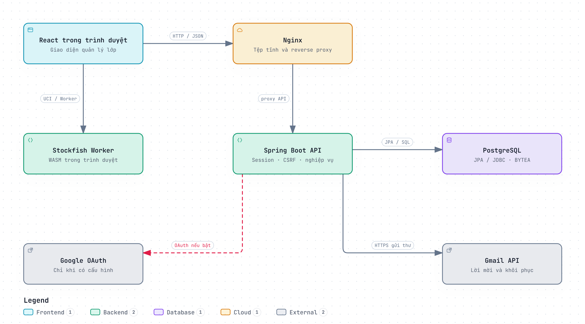
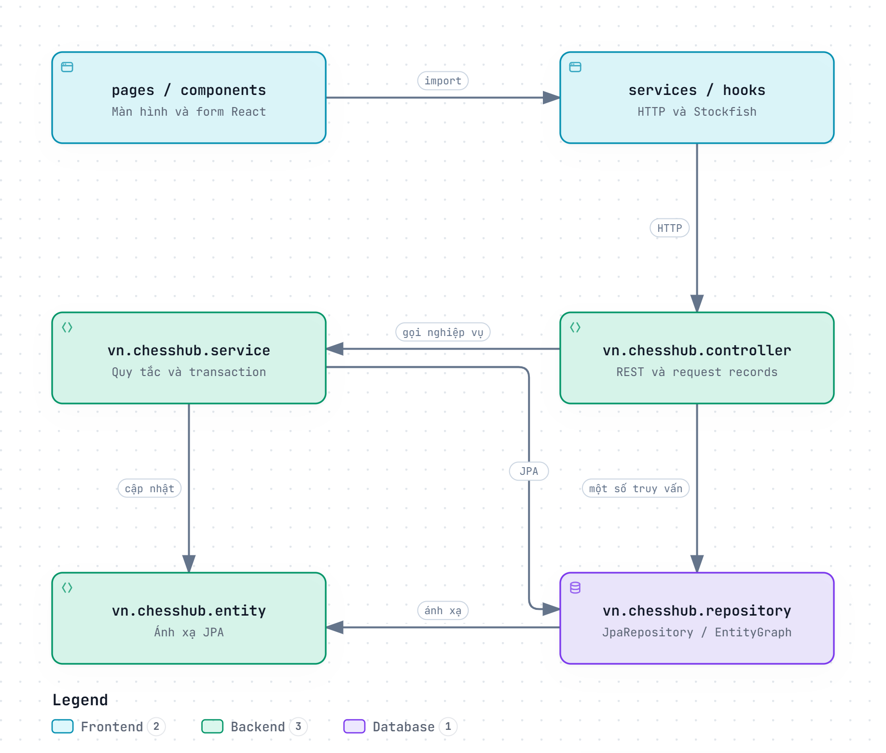
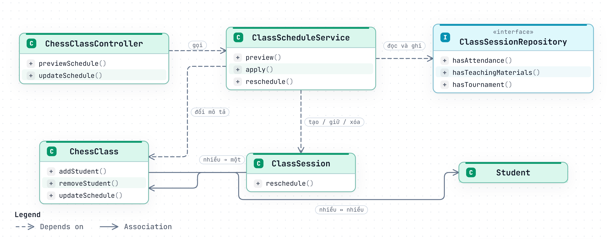
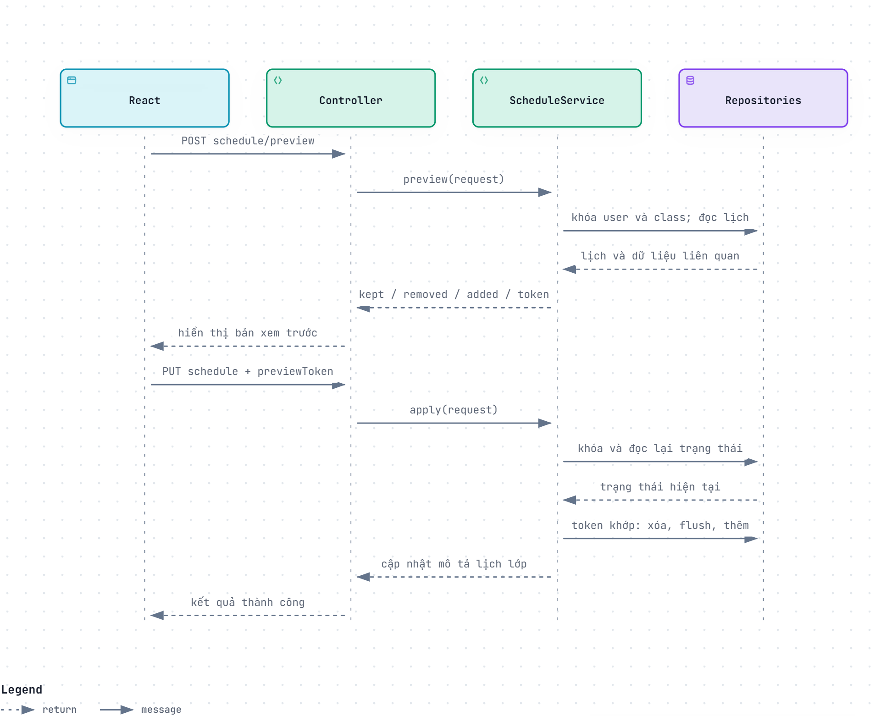

# ChessHub

Đặc tả thiết kế phần mềm

Ngày 22 tháng 10 năm 2026 · Phiên bản 1.0

## Tóm tắt điều hành

ChessHub hỗ trợ giáo viên và chủ trung tâm quản lý lớp học, học viên, lịch dạy, điểm danh, bài giảng và giải Swiss. Tài liệu này đặc tả thiết kế hiện tại để phục vụ phát triển, bảo trì và đánh giá phần mềm.

React đảm nhiệm giao diện và Stockfish Web Worker. Spring Boot kiểm soát quyền và transaction; PostgreSQL lưu dữ liệu nghiệp vụ cùng tệp bài giảng. Các tích hợp ngoài gồm Google OAuth và Gmail API.

### Các phát hiện chính

| Thành phần | Thiết kế hiện tại | Ý nghĩa |
| --- | --- | --- |
| Xác thực | HttpSession, cookie, CSRF và remember token | Cần bảo toàn phiên khi triển khai nhiều instance |
| Truy cập dữ liệu | Kết hợp Spring Data JPA và JDBC | Phải kiểm tra cả entity lẫn SQL khi thay đổi schema |
| Lịch dạy | Khóa dữ liệu, xem trước và fingerprint | Tránh áp dụng bản xem trước đã lỗi thời |
| Lịch sử | Giữ điểm danh khi học viên rời lớp; xóa mềm bài giảng | Báo cáo cũ vẫn truy xuất được theo quyền hiện tại |
| Giải Swiss | Sinh từng vòng, chốt kết quả rồi tạo vòng kế tiếp | round_count là số vòng đã tạo, không phải giới hạn định trước |

### Phạm vi phiên bản

Revision b7fab523739b79af2e26fba0e92e533fa7cd3b6e. “Hiện trạng” mô tả mã nguồn; “Khuyến nghị” là đề xuất chưa triển khai. Project chưa xác lập chỉ tiêu nghiệm thu tải, SLA, RPO và RTO.

### Nhật ký thay đổi

22/10/2026 — Phiên bản 1.0: bổ sung đặc tả kiến trúc, package, dữ liệu, chức năng và yêu cầu phi chức năng.

## I Thiết kế tổng thể

### 1 Kiến trúc phần mềm

Ứng dụng tổ chức theo mô hình web client–server với một backend triển khai tập trung. Đây là kiến trúc monolith phân lớp, không có bằng chứng về các microservice triển khai độc lập. Backend sử dụng Java 21, Spring Boot 3.5.6, Spring Web, Security, OAuth2 Client, Data JPA và Flyway. Frontend khai báo React 19, Vite 7, chess.js và react-chessboard. Docker Compose dùng image postgis/postgis:17-3.5 cho PostgreSQL; sự hiện diện của PostGIS không đồng nghĩa đã có nghiệp vụ GIS. [S1]

Trên môi trường Compose, web được công bố tại cổng 4173, API tại cổng 3000 và database tại cổng 5432. Nginx phục vụ bundle React, tệp WASM và proxy các đường dẫn API, health và OAuth. Trong chế độ Vite development, client mặc định gọi API tại localhost:3000. Chưa có cấu hình TLS termination hoặc topology production hoàn chỉnh trong Compose này. [S1, S2]

| Thành phần | Trách nhiệm | Giao tiếp |
| --- | --- | --- |
| React SPA | Màn hình nghiệp vụ, trạng thái tương tác, gửi request có credentials | HTTP JSON và multipart |
| Nginx | Phục vụ SPA, định tuyến deep link, proxy API và OAuth | API_UPSTREAM; giới hạn body 21m |
| Spring Security | Khôi phục phiên, CSRF, chặn tài khoản cần đổi mật khẩu, kiểm tra account path | Filter chain trước controller |
| Controller và service | Ánh xạ REST, kiểm tra đầu vào, quyền và transaction | JPA repository hoặc JDBC |
| PostgreSQL | Tài khoản, quan hệ lớp học, lịch sử, giải đấu, BYTEA bài giảng | JDBC datasource |
| Google OAuth | Đăng nhập khi client registration được cấu hình | OpenID profile và email |
| Gmail API | Gửi mật khẩu tạm và liên kết khôi phục | HTTPS và access token từ refresh token |
| Stockfish Worker | Phân tích thế cờ trên thiết bị người dùng | UCI qua postMessage |

Không có cache Redis, message broker hoặc object storage trong thiết kế đang triển khai. Biến JWT_SECRET trong Compose không chứng minh ứng dụng dùng JWT; chuỗi xác thực thực tế lưu SecurityContext vào HttpSession. [S1, S3]

### 2 Thiết kế package

Sơ đồ package dùng các khối thành phần để mô tả phụ thuộc mã nguồn. Các package không phải những tiến trình riêng. Luồng phổ biến là màn hình → HTTP helper → controller → service → repository/entity. Một số controller truy vấn repository trực tiếp; CenterService, StudentManagementService, TeachingMaterialService và các service token sử dụng JDBC. [S2, S4]

| Package hoặc thư mục | Nội dung | Quy ước |
| --- | --- | --- |
| frontend/src/pages | Màn hình lớp, học viên, lịch, trung tâm, tài liệu, giải đấu | PascalCase và hậu tố Page.jsx |
| frontend/src/components | Form, lịch, bố cục, bàn cờ, thành phần dùng lại | PascalCase cho React component |
| frontend/src/services | api.js, chessGame.js, stockfishClient.js, điều hướng | camelCase cho hàm/module tiện ích |
| frontend/src/hooks | useChessAnalysis, useHealth | Tiền tố use cho hook |
| vn.chesshub.config | SecurityConfig, OAuth config, các filter | Cấu hình hạ tầng và bảo mật |
| vn.chesshub.controller | REST controller, request/response records | Hậu tố Controller; DTO record thường nằm trong lớp |
| vn.chesshub.service | Quy tắc nghiệp vụ và điều phối transaction | Hậu tố Service; SwissPairing là lớp thuật toán nội bộ |
| vn.chesshub.repository | Interface JpaRepository, query, EntityGraph, lock | Hậu tố Repository |
| vn.chesshub.entity | Entity và liên kết JPA | PascalCase; tên bảng snake_case |
| resources/db/migration | Thay đổi DDL và chuyển đổi dữ liệu | Vn__description.sql, có V7_1 |

API sử dụng tiền tố /api/v1. Các tài nguyên theo giáo viên thường có /teachers/{teacherId}; trung tâm và tài khoản dùng /users/{userId}. Danh tính trong đường dẫn phải khớp principal hiện tại. Mã SQL dùng tên bảng snake_case, trong đó student là tên số ít đang tồn tại; không đổi tên thành students trong đặc tả. [S3, S4]

### 3 Thiết kế cơ sở dữ liệu

Nguồn thiết kế dữ liệu gồm migration Flyway và ánh xạ JPA. Migration khai báo 17 bảng nghiệp vụ hiện hành; bảng nối chess_class_students do @JoinTable khai báo và Hibernate tạo/cập nhật. Tổng cộng 18 bảng với 119 cột trong từ điển bên dưới. flyway_schema_history là bảng hạ tầng, không thuộc danh mục nghiệp vụ. Đây là lược đồ dự kiến từ mã nguồn, không phải kết quả introspection một database đang chạy. [S5]

ERD tương tác đi kèm tại design/database.html. Từ điển dưới đây giữ nguyên kiểu SQL, nullability, khóa và ràng buộc có bằng chứng. Một cột có nhiều vai trò được ghi đồng thời; UK của chỉ mục ghép không có nghĩa từng cột tự nó duy nhất.

Các nhóm dữ liệu gồm tài khoản và token; trung tâm và thành viên; học viên, lớp và buổi học; tài liệu; giải đấu. Quan hệ học viên–lớp là nhiều–nhiều. Một buổi học thuộc một lớp. Một bản ghi điểm danh gắn một học viên với một buổi học. Giải đấu có thể đứng độc lập, gắn lớp hoặc gắn buổi học; người chơi khách không bắt buộc có hồ sơ student. [S5, S6]

### 3 1 Các quyết định dữ liệu cần lưu ý

users.center_id là UUID nhưng migration không khai báo FK tới centers. class_sessions.class_id có quan hệ @ManyToOne trong JPA; V4 chưa khai báo FK này. Không nên mô tả hai trường đó như có cùng mức ràng buộc tại Flyway. [S5]

student.center_id và owner_user_id có FK, nhưng CHECK “chính xác một chủ sở hữu” mới xuất hiện dưới dạng comment trong V7. Service tạo mới kiểm soát phạm vi sở hữu; dữ liệu legacy không có owner vẫn được xử lý thông qua lớp học. parent_name và birth_date có thể NULL ở schema mặc dù ngày sinh là đầu vào bắt buộc của luồng tạo mới hiện tại. parent_phone_number NOT NULL nhưng service cho phép chuỗi rỗng khi không nhập. [S5, S7]

teaching_materials có hai CHECK XOR: đúng một phạm vi owner_user_id/center_id và đúng một nguồn source_url/file_data. deleted_at phục vụ xóa mềm. session_materials có khóa chính ghép (session_id, material_id), nhờ đó gắn cùng bài giảng nhiều lần có thể xử lý idempotent bằng ON CONFLICT DO NOTHING. [S5, S8]

remember_login_tokens.expires_at được chuyển sang nullable ở V18. Token phía server có thể tồn tại tới khi thu hồi; cookie vẫn có thời hạn hữu hạn và được gia hạn khi khôi phục phiên. password_reset_tokens giữ snapshot email và password hash để phát hiện liên kết không còn phù hợp sau thay đổi tài khoản. [S3, S9]

#### 3 2 users

Tài khoản người dùng và cấu hình cá nhân.

| Cột | Kiểu SQL | NULL và khóa | Ràng buộc hoặc diễn giải |
| --- | --- | --- | --- |
| id | UUID | Không · PK | Định danh bản ghi. |
| center_id | UUID | Có | Trung tâm sở hữu hoặc liên quan. Tham chiếu nghiệp vụ; chưa có FK Flyway. |
| email | VARCHAR(255) | Không · UK | Địa chỉ email tài khoản. |
| full_name | VARCHAR(255) | Không | Họ tên được lưu. |
| role | VARCHAR(255) | Không | Vai trò tài khoản hoặc thành viên. |
| password_hash | VARCHAR(255) | Có | Mật khẩu đã băm BCrypt; có thể NULL với Google. |
| created_at | TIMESTAMP WITH TIME ZONE | Không | Thời điểm tạo bản ghi. |
| google_subject | VARCHAR(255) | Có · UK | Định danh subject của tài khoản Google. |
| must_change_password | BOOLEAN | Không | Yêu cầu đổi mật khẩu tạm trước khi dùng nghiệp vụ. DEFAULT FALSE |
| google_meet_url | VARCHAR(512) | Có | Liên kết Google Meet do người dùng cấu hình. |

Ràng buộc cấp bảng và chỉ mục: UNIQUE (email); UNIQUE (google_subject).

Nguồn: V1__merge_teacher_accounts_into_users.sql, V9__add_google_oauth_accounts.sql, V11__require_initial_password_change.sql, V14__add_account_google_meet_url.sql, V2__enforce_unique_user_emails.sql. [S5]

#### 3 3 remember_login_tokens

Token ghi nhớ phiên dạng hash, có thể chưa có ngày hết hạn.

| Cột | Kiểu SQL | NULL và khóa | Ràng buộc hoặc diễn giải |
| --- | --- | --- | --- |
| token_hash | VARCHAR(64) | Không · PK | SHA-256 của token; không lưu token rõ. |
| user_id | UUID | Không · FK | Tài khoản liên quan. REFERENCES users(id) ON DELETE CASCADE |
| expires_at | TIMESTAMP WITH TIME ZONE | Có | Mốc hết hạn; NULL được cho phép ở remember token. |

Ràng buộc cấp bảng và chỉ mục: INDEX (expires_at).

Nguồn: V10__create_remember_login_tokens.sql, V18__remember_login_until_revoked.sql. [S5]

#### 3 4 password_reset_tokens

Token khôi phục một lần cùng snapshot tài khoản.

| Cột | Kiểu SQL | NULL và khóa | Ràng buộc hoặc diễn giải |
| --- | --- | --- | --- |
| token_hash | VARCHAR(64) | Không · PK | SHA-256 của token; không lưu token rõ. |
| user_id | UUID | Không · FK | Tài khoản liên quan. REFERENCES users(id) ON DELETE CASCADE |
| email | VARCHAR(255) | Không | Địa chỉ email tài khoản. |
| password_hash_at_request | VARCHAR(255) | Có | Snapshot hash để kiểm tra token còn phù hợp. |
| created_at | TIMESTAMP WITH TIME ZONE | Không | Thời điểm tạo bản ghi. |
| expires_at | TIMESTAMP WITH TIME ZONE | Không | Mốc hết hạn được lưu. |

Ràng buộc cấp bảng và chỉ mục: INDEX (user_id).

Nguồn: V19__create_password_reset_tokens.sql. [S5]

#### 3 5 centers

Trung tâm thuộc một người dùng chủ sở hữu. Các trường subscription là dữ liệu cấu trúc, chưa chứng minh có thanh toán.

| Cột | Kiểu SQL | NULL và khóa | Ràng buộc hoặc diễn giải |
| --- | --- | --- | --- |
| id | UUID | Không · PK | Định danh bản ghi. |
| owner_user_id | UUID | Không · FK | Chủ sở hữu là tài khoản người dùng. REFERENCES users(id) |
| name | VARCHAR(255) | Không | Tên hiển thị. |
| subscription_status | VARCHAR(32) | Không | Trạng thái gói của trung tâm. DEFAULT 'ACTIVE' |
| subscription_plan_code | VARCHAR(64) | Có | Mã gói được lưu. |
| subscription_started_at | TIMESTAMP WITH TIME ZONE | Có | Mốc bắt đầu gói được lưu. |
| subscription_ends_at | TIMESTAMP WITH TIME ZONE | Có | Mốc kết thúc gói được lưu. |
| created_at | TIMESTAMP WITH TIME ZONE | Không | Thời điểm tạo bản ghi. DEFAULT CURRENT_TIMESTAMP |
| updated_at | TIMESTAMP WITH TIME ZONE | Không | Thời điểm cập nhật được lưu. DEFAULT CURRENT_TIMESTAMP |

Ràng buộc cấp bảng và chỉ mục: CHECK (subscription_status IN ('ACTIVE', 'PAST_DUE', 'CANCELLED', 'EXPIRED')); INDEX (owner_user_id).

Nguồn: V7__add_centers_and_scope_students.sql. [S5]

#### 3 6 center_memberships

Vai trò và trạng thái thành viên trong trung tâm.

| Cột | Kiểu SQL | NULL và khóa | Ràng buộc hoặc diễn giải |
| --- | --- | --- | --- |
| center_id | UUID | Không · FK, PK | Trung tâm sở hữu hoặc liên quan. REFERENCES centers(id) ON DELETE CASCADE |
| user_id | UUID | Không · FK, PK | Tài khoản liên quan. REFERENCES users(id) ON DELETE CASCADE |
| role | VARCHAR(32) | Không | Vai trò tài khoản hoặc thành viên. DEFAULT 'TEACHER' |
| status | VARCHAR(32) | Không | Trạng thái nghiệp vụ. DEFAULT 'ACTIVE' |
| joined_at | TIMESTAMP WITH TIME ZONE | Không | Thời điểm gia nhập được lưu. DEFAULT CURRENT_TIMESTAMP |

Ràng buộc cấp bảng và chỉ mục: PRIMARY KEY (center_id, user_id); CHECK (role IN ('OWNER', 'ADMIN', 'TEACHER')); CHECK (status IN ('ACTIVE', 'SUSPENDED', 'LEFT')); INDEX (user_id) WHERE status = 'ACTIVE'.

Nguồn: V7__add_centers_and_scope_students.sql. [S5]

#### 3 7 center_invitations

Lời mời tham gia và phản hồi.

| Cột | Kiểu SQL | NULL và khóa | Ràng buộc hoặc diễn giải |
| --- | --- | --- | --- |
| id | UUID | Không · PK | Định danh bản ghi. |
| center_id | UUID | Không · FK, UK | Trung tâm sở hữu hoặc liên quan. REFERENCES centers(id) ON DELETE CASCADE |
| invited_user_id | UUID | Không · FK, UK | Tài khoản được mời. REFERENCES users(id) ON DELETE CASCADE |
| invited_by_user_id | UUID | Không · FK | Tài khoản gửi lời mời. REFERENCES users(id) |
| role | VARCHAR(32) | Không | Vai trò tài khoản hoặc thành viên. DEFAULT 'TEACHER' |
| status | VARCHAR(32) | Không | Trạng thái nghiệp vụ. DEFAULT 'PENDING' |
| created_at | TIMESTAMP WITH TIME ZONE | Không | Thời điểm tạo bản ghi. DEFAULT CURRENT_TIMESTAMP |
| responded_at | TIMESTAMP WITH TIME ZONE | Có | Thời điểm phản hồi hoặc hủy lời mời. |
| expires_at | TIMESTAMP WITH TIME ZONE | Có | Mốc hết hạn được lưu. |

Ràng buộc cấp bảng và chỉ mục: CHECK (role IN ('ADMIN', 'TEACHER')); CHECK (status IN ('PENDING', 'ACCEPTED', 'DECLINED', 'CANCELLED')); UNIQUE (center_id, invited_user_id) WHERE status = 'PENDING'; INDEX (invited_user_id) WHERE status = 'PENDING'.

Nguồn: V7__add_centers_and_scope_students.sql. [S5]

#### 3 8 student

Hồ sơ học viên theo phạm vi sở hữu.

| Cột | Kiểu SQL | NULL và khóa | Ràng buộc hoặc diễn giải |
| --- | --- | --- | --- |
| id | UUID | Không · PK | Định danh bản ghi. |
| full_name | VARCHAR(255) | Không · UK | Họ tên được lưu. |
| phone_number | VARCHAR(15) | Có | Số điện thoại học viên, có thể để trống. |
| parent_phone_number | VARCHAR(15) | Không · UK | Số phụ huynh; service cho phép chuỗi rỗng. |
| created_at | TIMESTAMP WITH TIME ZONE | Không | Thời điểm tạo bản ghi. DEFAULT CURRENT_TIMESTAMP |
| center_id | UUID | Có · FK, UK | Trung tâm sở hữu hoặc liên quan. REFERENCES centers(id) ON DELETE CASCADE |
| owner_user_id | UUID | Có · FK, UK | Chủ sở hữu là tài khoản người dùng. REFERENCES users(id) ON DELETE CASCADE |
| parent_name | VARCHAR(255) | Có | Họ tên phụ huynh, có thể để trống. |
| birth_date | DATE | Có · UK | Ngày sinh học viên. |
| updated_at | TIMESTAMP WITH TIME ZONE | Không | Thời điểm cập nhật được lưu. DEFAULT CURRENT_TIMESTAMP; update service hiện không gán lại trường này. |
| notes | VARCHAR(4000) | Có | Ghi chú học viên. |

Ràng buộc cấp bảng và chỉ mục: INDEX (center_id) WHERE center_id IS NOT NULL; INDEX (owner_user_id) WHERE owner_user_id IS NOT NULL; UNIQUE (center_id, full_name, birth_date, parent_phone_number) WHERE center_id IS NOT NULL; UNIQUE (owner_user_id, full_name, birth_date, parent_phone_number) WHERE owner_user_id IS NOT NULL.

Nguồn: V3__create_student_table.sql, V7__add_centers_and_scope_students.sql, V20__add_student_notes.sql. [S5]

#### 3 9 chess_classes

Lớp học thuộc một giáo viên, học phí và số lượng học viên.

| Cột | Kiểu SQL | NULL và khóa | Ràng buộc hoặc diễn giải |
| --- | --- | --- | --- |
| id | UUID | Không · PK | Định danh bản ghi. |
| teacher_id | UUID | Không · FK | Giáo viên sở hữu lớp hoặc giải. REFERENCES users(id) |
| name | VARCHAR(255) | Không | Tên hiển thị. |
| schedule | VARCHAR(255) | Không | Mô tả lịch lớp; lịch cụ thể nằm ở class_sessions. |
| student_count | INTEGER | Không | Số học viên hiện có trong tập students. DEFAULT 0 |
| tone | VARCHAR(255) | Không | Mã màu giao diện lớp. |
| fee_per_session | NUMERIC(12, 0) | Không | Mức phí mỗi buổi hiện tại của lớp. DEFAULT 0 |

Ràng buộc cấp bảng và chỉ mục: CHECK (fee_per_session >= 0).

Nguồn: V7_1__create_chess_classes_table.sql, V8__add_class_fee_per_session.sql. [S5]

#### 3 10 chess_class_students

Quan hệ nhiều–nhiều giữa lớp và học viên; nguồn @JoinTable trong ChessClass.

| Cột | Kiểu SQL | NULL và khóa | Ràng buộc hoặc diễn giải |
| --- | --- | --- | --- |
| chess_class_id | UUID | Không · FK | Lớp trong quan hệ nhiều–nhiều. FK JPA → chess_classes(id) |
| student_id | UUID | Không · FK | Học viên liên quan. FK JPA → student(id) |

Ràng buộc cấp bảng và chỉ mục: Bảng nối @ManyToMany từ Set<Student>; schema vật lý do Hibernate sinh, chưa có CREATE TABLE Flyway riêng. Không xác nhận tên constraint vật lý khi chưa introspect DB..

Nguồn: ChessClass.java. [S5]

#### 3 11 class_sessions

Buổi học cụ thể và cờ sửa lịch riêng.

| Cột | Kiểu SQL | NULL và khóa | Ràng buộc hoặc diễn giải |
| --- | --- | --- | --- |
| id | UUID | Không · PK | Định danh bản ghi. |
| class_id | UUID | Không | Lớp học liên quan. Quan hệ FK JPA tới chess_classes.id; V4 chỉ khai báo UUID. |
| session_date | DATE | Không | Ngày diễn ra buổi học. |
| start_time | TIME | Không | Giờ bắt đầu. |
| end_time | TIME | Không | Giờ kết thúc. |
| schedule_override | BOOLEAN | Không | Buổi đã được đổi lịch riêng. DEFAULT FALSE |

Ràng buộc cấp bảng và chỉ mục: CHECK (end_time > start_time); INDEX (class_id, session_date).

Nguồn: V4__create_class_sessions_table.sql, V17__mark_session_schedule_overrides.sql. [S5]

#### 3 12 session_attendance

Điểm danh của một học viên trong một buổi.

| Cột | Kiểu SQL | NULL và khóa | Ràng buộc hoặc diễn giải |
| --- | --- | --- | --- |
| id | UUID | Không · PK | Định danh bản ghi. |
| session_id | UUID | Không · FK, UK | Buổi học liên quan. REFERENCES class_sessions(id) ON DELETE CASCADE |
| student_id | UUID | Không · FK, UK | Học viên liên quan. REFERENCES student(id) ON DELETE CASCADE |
| status | VARCHAR(20) | Không | Trạng thái nghiệp vụ. |
| noted_at | TIMESTAMP WITH TIME ZONE | Không | Thời điểm ghi hoặc sửa điểm danh. DEFAULT CURRENT_TIMESTAMP |

Ràng buộc cấp bảng và chỉ mục: CHECK (status IN ('PRESENT', 'ABSENT', 'LATE')); UNIQUE (session_id, student_id); INDEX (session_id).

Nguồn: V5__create_session_attendance.sql. [S5]

#### 3 13 teaching_materials

Metadata và nguồn bài giảng; file binary lưu BYTEA.

| Cột | Kiểu SQL | NULL và khóa | Ràng buộc hoặc diễn giải |
| --- | --- | --- | --- |
| id | UUID | Không · PK | Định danh bản ghi. |
| owner_user_id | UUID | Có · FK | Chủ sở hữu là tài khoản người dùng. REFERENCES users(id) ON DELETE CASCADE |
| center_id | UUID | Có · FK | Trung tâm sở hữu hoặc liên quan. REFERENCES centers(id) ON DELETE CASCADE |
| title | VARCHAR(255) | Không | Tên bài giảng. |
| description | VARCHAR(4000) | Không | Mô tả bài giảng. DEFAULT '' |
| source_url | VARCHAR(2048) | Có | Nguồn bài giảng dạng liên kết HTTPS. |
| file_name | VARCHAR(255) | Có | Tên tệp sau khi bỏ thành phần đường dẫn. |
| content_type | VARCHAR(128) | Có | MIME type của tệp. |
| file_data | BYTEA | Có | Nội dung tệp binary. |
| deleted_at | TIMESTAMPTZ | Có | Mốc xóa mềm khỏi thư viện. |
| created_at | TIMESTAMPTZ | Không | Thời điểm tạo bản ghi. DEFAULT CURRENT_TIMESTAMP |
| updated_at | TIMESTAMPTZ | Không | Thời điểm cập nhật được lưu. DEFAULT CURRENT_TIMESTAMP |

Ràng buộc cấp bảng và chỉ mục: CHECK ((owner_user_id IS NULL) <> (center_id IS NULL)); CHECK ((source_url IS NULL) <> (file_data IS NULL)); INDEX (owner_user_id) WHERE deleted_at IS NULL; INDEX (center_id) WHERE deleted_at IS NULL.

Nguồn: V16__create_teaching_materials.sql. [S5]

#### 3 14 session_materials

Liên kết bài giảng với buổi học.

| Cột | Kiểu SQL | NULL và khóa | Ràng buộc hoặc diễn giải |
| --- | --- | --- | --- |
| session_id | UUID | Không · FK, PK | Buổi học liên quan. REFERENCES class_sessions(id) ON DELETE CASCADE |
| material_id | UUID | Không · FK, PK | Bài giảng được gắn vào buổi. REFERENCES teaching_materials(id) ON DELETE CASCADE |
| added_at | TIMESTAMPTZ | Không | Thời điểm gắn bài giảng. DEFAULT CURRENT_TIMESTAMP |

Ràng buộc cấp bảng và chỉ mục: PRIMARY KEY (session_id, material_id).

Nguồn: V16__create_teaching_materials.sql. [S5]

#### 3 15 tournaments

Giải đấu độc lập hoặc gắn lớp/buổi học.

| Cột | Kiểu SQL | NULL và khóa | Ràng buộc hoặc diễn giải |
| --- | --- | --- | --- |
| id | UUID | Không · PK | Định danh bản ghi. |
| session_id | UUID | Có · FK | Buổi học liên quan. REFERENCES class_sessions(id) |
| round_count | INTEGER | Không | Số vòng đã được tạo. |
| status | VARCHAR(32) | Không | Trạng thái nghiệp vụ. DEFAULT 'ACTIVE' |
| created_at | TIMESTAMP WITH TIME ZONE | Không | Thời điểm tạo bản ghi. DEFAULT CURRENT_TIMESTAMP |
| teacher_id | UUID | Không · FK | Giáo viên sở hữu lớp hoặc giải. REFERENCES users(id) |
| name | VARCHAR(255) | Không | Tên hiển thị. |
| class_id | UUID | Có · FK | Lớp học liên quan. REFERENCES chess_classes(id) |

Ràng buộc cấp bảng và chỉ mục: INDEX (teacher_id, created_at DESC); INDEX (class_id).

Nguồn: V6__create_swiss_tournament_rounds.sql, V12__allow_standalone_open_ended_tournaments.sql, V13__link_tournaments_directly_to_classes.sql. [S5]

#### 3 16 tournament_participants

Người tham gia, seed và tên được lưu cho giải.

| Cột | Kiểu SQL | NULL và khóa | Ràng buộc hoặc diễn giải |
| --- | --- | --- | --- |
| id | UUID | Không · PK | Định danh bản ghi. |
| tournament_id | UUID | Không · FK, UK | Giải đấu liên quan. REFERENCES tournaments(id) |
| student_id | UUID | Có · FK, UK | Học viên liên quan; có thể NULL với khách giải đấu. REFERENCES student(id) |
| initial_seed | INTEGER | Không | Thứ tự seed được lưu khi tạo roster. DEFAULT 0 |
| full_name | VARCHAR(255) | Không | Họ tên được lưu. |

Ràng buộc cấp bảng và chỉ mục: UNIQUE (tournament_id, student_id).

Nguồn: V6__create_swiss_tournament_rounds.sql, V12__allow_standalone_open_ended_tournaments.sql. [S5]

#### 3 17 tournament_tie_breaks

Tiêu chí phân hạng phụ và thứ tự áp dụng.

| Cột | Kiểu SQL | NULL và khóa | Ràng buộc hoặc diễn giải |
| --- | --- | --- | --- |
| id | UUID | Không · PK | Định danh bản ghi. |
| tournament_id | UUID | Không · FK, UK | Giải đấu liên quan. REFERENCES tournaments(id) |
| tie_break_type | VARCHAR(64) | Không · UK | Mã tiêu chí phân hạng phụ. |
| sort_order | INTEGER | Không | Thứ tự áp dụng tiêu chí. |

Ràng buộc cấp bảng và chỉ mục: UNIQUE (tournament_id, tie_break_type).

Nguồn: V6__create_swiss_tournament_rounds.sql. [S5]

#### 3 18 tournament_rounds

Vòng đấu, trạng thái và thông tin chất lượng ghép cặp.

| Cột | Kiểu SQL | NULL và khóa | Ràng buộc hoặc diễn giải |
| --- | --- | --- | --- |
| id | UUID | Không · PK | Định danh bản ghi. |
| tournament_id | UUID | Không · FK, UK | Giải đấu liên quan. REFERENCES tournaments(id) |
| round_number | INTEGER | Không · UK | Số thứ tự vòng trong giải. |
| status | VARCHAR(32) | Không | Trạng thái nghiệp vụ. |
| finalized_at | TIMESTAMP WITH TIME ZONE | Có | Thời điểm chốt vòng. |
| pairing_note | VARCHAR(1000) | Có | Giải thích chất lượng ghép cặp. |
| pairing_search_limited | BOOLEAN | Không | Bộ tìm kiếm đã chạm giới hạn ngân sách. DEFAULT FALSE |

Ràng buộc cấp bảng và chỉ mục: UNIQUE (tournament_id, round_number).

Nguồn: V6__create_swiss_tournament_rounds.sql, V15__add_swiss_pairing_notes.sql. [S5]

#### 3 19 tournament_pairings

Bàn đấu, hai người chơi và kết quả; đen có thể NULL khi BYE.

| Cột | Kiểu SQL | NULL và khóa | Ràng buộc hoặc diễn giải |
| --- | --- | --- | --- |
| id | UUID | Không · PK | Định danh bản ghi. |
| round_id | UUID | Không · FK, UK | Vòng đấu chứa bàn. REFERENCES tournament_rounds(id) |
| board_number | INTEGER | Không · UK | Số bàn trong vòng. |
| white_participant_id | UUID | Không · FK | Người chơi quân trắng. REFERENCES tournament_participants(id) |
| black_participant_id | UUID | Có · FK | Người chơi quân đen; NULL khi BYE. REFERENCES tournament_participants(id) |
| result | VARCHAR(32) | Không | Kết quả hoặc trạng thái chờ của bàn. |
| result_recorded_at | TIMESTAMP WITH TIME ZONE | Có | Thời điểm ghi kết quả. |

Ràng buộc cấp bảng và chỉ mục: UNIQUE (round_id, board_number).

Nguồn: V6__create_swiss_tournament_rounds.sql. [S5]

## II Thiết kế mã chi tiết

### 1 Tài khoản và xác thực

AuthController điều phối đăng ký, đăng nhập, lấy thông tin phiên, đăng xuất, đổi mật khẩu lần đầu và cài đặt tài khoản. AuthService chuẩn hóa email về chữ thường, kiểm tra định dạng, kiểm tra mật khẩu tối thiểu 8 ký tự và tối đa 72 byte UTF-8, rồi dùng BCryptPasswordEncoder. Mật khẩu không được trả về trong AccountResponse. [S3]

Trình tự đăng nhập: client lấy CSRF token; gửi POST /api/v1/auth/login; AuthService tìm user theo email và kiểm tra BCrypt; controller tạo hoặc lấy session, đổi session ID, lưu SecurityContext với principal là UUID và authority ROLE_USER. Nếu tài khoản không phải đổi mật khẩu và rememberMe không bằng false, controller phát hành remember token. Sai thông tin đăng nhập được trả bằng thông báo chung. [S2, S3]

GoogleOAuthConfig chỉ tạo client registration khi có đủ cấu hình client-id và client-secret. AuthService yêu cầu Google xác minh email; ưu tiên tìm theo subject, sau đó có thể liên kết tài khoản đã tồn tại theo email xác minh. User Google có thể chưa có password_hash. InitialPasswordFilter hạn chế quyền tiếp tục nghiệp vụ của tài khoản được cấp mật khẩu tạm cho tới khi hoàn tất đổi mật khẩu. [S3]

Khôi phục mật khẩu dùng token ngẫu nhiên 32 byte, lưu SHA-256 thay vì token rõ, hết hạn sau 1.800 giây. Yêu cầu mới bị hạn chế theo cửa sổ 60 giây trên tài khoản. Khi đổi mật khẩu, service khóa tài khoản, đối chiếu email và password_hash_at_request, tiêu thụ token còn hiệu lực và thu hồi remember token. Thiếu cấu hình mail trả lỗi dịch vụ ngay cả với email không tồn tại để tránh tiết lộ sự tồn tại tài khoản qua nhánh đó. Không có bằng chứng rằng mọi HttpSession trên các thiết bị khác đều bị hủy toàn cục. [S9]

### 2 Trung tâm và lời mời giáo viên

CenterController gọi CenterService; service dùng JdbcTemplate cho centers, memberships và invitations, đồng thời dùng UserRepository khi cần tạo tài khoản. Bảng membership có thể biểu diễn nhiều trung tâm theo cấu trúc khóa ghép, nhưng nghiệp vụ hiện tại chặn người đã có membership ACTIVE hoặc đã sở hữu trung tâm tham gia trung tâm khác. [S10]

Tạo trung tâm khóa user, kiểm tra điều kiện, tạo hoặc dùng lại trung tâm sở hữu, ghi membership OWNER/ACTIVE và cập nhật users.center_id. Service chuyển hồ sơ cá nhân phù hợp sang phạm vi trung tâm; với hồ sơ legacy, chỉ chia sẻ khi hồ sơ chỉ được dùng trong các lớp của chủ trung tâm đó. [S10]

Trình tự mời: chủ trung tâm gửi email → kiểm tra quyền owner → tìm user → nếu chưa có thì kiểm tra mail, tạo mật khẩu tạm và đánh dấu must_change_password → kiểm tra membership và lời mời trùng → ghi invitation PENDING → gửi email nếu tạo tài khoản mới, hoặc thông báo IN_APP nếu tài khoản đã tồn tại. Không coi lời mời là được chấp nhận ngay sau khi gửi. [S10]

Chấp nhận lời mời khóa user và invitation; nếu còn hợp lệ thì ghi membership TEACHER/ACTIVE, cập nhật center_id, hủy các lời mời PENDING khác và chuyển lời mời được chọn sang ACCEPTED. Từ chối chuyển sang DECLINED. Xóa thành viên chuyển membership sang LEFT và bỏ center_id, không xóa tài khoản; không được xóa chính owner qua thao tác này. [S10]

### 3 Hồ sơ học viên và danh sách lớp

StudentManagementService quản lý hồ sơ theo phạm vi cá nhân hoặc trung tâm, tìm kiếm không dấu và phân trang 25/50 bản ghi. Truy vấn dùng NamedParameterJdbcTemplate, bind tham số và escape ký tự wildcard. Hồ sơ trung tâm được đọc theo membership ACTIVE và trung tâm hiện tại; quyền sửa thuộc chủ hồ sơ cá nhân hoặc chủ trung tâm. Giáo viên thành viên có thể tạo học viên trong trung tâm được phép nhưng không vì thế có quyền sửa mọi hồ sơ. [S7]

Tạo hoặc sửa hồ sơ khóa user, chuẩn hóa họ tên, kiểm tra ngày sinh không ở tương lai, kiểm tra số điện thoại 9–15 chữ số nếu có và ghi chú tối đa 4.000 ký tự. Kiểm tra trùng dựa trên tên, ngày sinh, số phụ huynh và phạm vi. Service so sánh tên sau lower/trim; chỉ mục unique vật lý dùng giá trị lưu thực tế, vì vậy không được coi hai lớp kiểm tra hoàn toàn tương đương. Sửa hồ sơ không được chuyển phạm vi sở hữu. [S7]

ChessClassService thêm/xóa liên kết học viên với lớp. Khi học viên rời lớp, hệ thống xóa liên kết hiện tại và cập nhật student_count, giữ hồ sơ và lịch sử điểm danh. Trang chi tiết học viên phân trang lịch sử 20 bản ghi, chỉ lấy lịch sử lớp thuộc giáo viên hiện tại. [S6, S7]

### 4 Lớp học và lịch dạy

ChessClass giữ teacher, name, schedule, studentCount, tone, feePerSession và tập students. ClassSession giữ ngày, giờ bắt đầu/kết thúc và scheduleOverride. Repository tìm lớp theo cả classId và teacherId; findForUpdate sử dụng PESSIMISTIC_WRITE. ClassScheduleService còn khóa user để tuần tự hóa thay đổi lịch giữa nhiều lớp của cùng giáo viên. [S6, S11]

POST /schedule/preview nhận ngày bắt đầu/kết thúc, danh sách thứ, giờ bắt đầu và kết thúc. Service sinh các slot tương lai, đọc lịch của giáo viên, phân chia buổi được giữ/xóa/thêm và tạo token SHA-256 từ yêu cầu cùng trạng thái liên quan. PUT /schedule nhận lại previewToken, tính lại kế hoạch dưới khóa và chỉ áp dụng khi token khớp. Xóa buổi, flush và thêm buổi mới nằm trong một transaction. Token sai trả 409 và yêu cầu xem trước lại. [S11]

Khoảng lịch lặp tối đa 730 ngày và từ 1 đến 500 buổi chưa bắt đầu. Thứ dùng 1–7; giờ kết thúc phải sau giờ bắt đầu. Xung đột xảy ra khi hai buổi cùng ngày và khoảng thời gian giao nhau theo bất đẳng thức nghiêm ngặt; hai buổi liền nhau đúng ở mốc kết thúc không bị coi là giao nhau. Múi giờ nghiệp vụ là Asia/Ho_Chi_Minh. [S11]

Buổi đã bắt đầu, có điểm danh, được sửa riêng, có bài giảng, có giải đấu hoặc có slot không đổi được bảo toàn khi thay lịch lặp. Đổi một buổi bằng PATCH không cho sửa buổi đã bắt đầu hoặc đã có điểm danh, yêu cầu lịch mới ở tương lai và không trùng lịch khác; thao tác đặt schedule_override=true. Hai luồng này có điều kiện riêng, không được gộp mọi quy tắc thành một điều kiện duy nhất. [S11]

### 5 Điểm danh và tổng hợp học phí

AttendanceController đang gọi repository trực tiếp trong transaction. PUT điểm danh khóa lớp, xác minh buổi học thuộc lớp và giáo viên, kiểm tra danh sách không null, không trùng studentId và chỉ nhận PRESENT, ABSENT hoặc LATE. Nếu học viên đã rời lớp, chỉ được chỉnh bản ghi điểm danh đã tồn tại; không tạo lịch sử mới cho người đã rời lớp. saveAll cập nhật tập bản ghi gửi lên, không xóa các bản ghi khác không nằm trong request. [S12]

AttendanceSummaryController tổng hợp theo tháng. PRESENT và LATE cùng được tính là một buổi tham dự; ABSENT được đếm riêng. tuitionAmount = số buổi tham dự × fee_per_session hiện tại của lớp. Danh sách báo cáo hợp nhất học viên đang học với những người có lịch sử trong tháng và gắn leftClass. [S12]

Đây là số tiền tính toán phục vụ báo cáo. Chưa có bảng hóa đơn, giao dịch thanh toán hoặc snapshot mức phí theo từng buổi. Thay đổi fee_per_session có thể làm số tiền báo cáo tháng cũ thay đổi khi tính lại. Nếu cần đối soát thu tiền, phải bổ sung mô hình ghi nhận phí và thanh toán riêng. [S12]

### 6 Thư viện bài giảng

TeachingMaterialController nhận multipart hoặc thông tin liên kết; TeachingMaterialService quản lý bằng JDBC. Một bài giảng thuộc thư viện cá nhân hoặc trung tâm. Chủ trung tâm quản lý bài giảng trung tâm; thành viên ACTIVE có thể đọc theo điều kiện ACCESS. Các thao tác gắn vào buổi học còn phải xác minh quyền giáo viên của chính buổi học. [S8]

Nguồn bài giảng là URL HTTPS hợp lệ hoặc một tệp PDF/PPT/PPTX tối đa 20 MB, không chấp nhận cả hai hoặc thiếu cả hai. Tên tệp được bỏ đường dẫn và ký tự điều khiển; kiểm tra nội dung sử dụng chữ ký PDF, OLE cho PPT hoặc cấu trúc entry ZIP cho PPTX. Metadata tìm kiếm dùng octet_length(file_data), không tải toàn bộ binary trong danh sách. Kết quả tìm kiếm tối đa 100 mục. Đây không phải hệ thống quét mã độc. [S8]

Gắn bài giảng: kiểm tra session → khóa class → kiểm tra lại session → khóa/đọc material có quyền → từ chối bài đã xóa → INSERT session_materials ON CONFLICT DO NOTHING → trả danh sách. Tạo bài giảng trực tiếp cho session tạo bài cá nhân rồi gắn trong cùng luồng transaction. Xóa khỏi thư viện chỉ đặt deleted_at; truy xuất bài đã xóa còn phụ thuộc liên kết với buổi của giáo viên và điều kiện quyền truy cập hiện hành. [S8]

### 7 Giải đấu Swiss

TournamentController và TeacherTournamentController sử dụng TournamentService. Các entity chính là Tournament, TournamentParticipant, TournamentTieBreak, TournamentRound và TournamentPairing; mỗi nhóm có repository tương ứng. SwissPairing là lớp package-private, nhận dữ liệu thuần trong bộ nhớ và trả cặp cùng chi phí; lớp này không trực tiếp ghi database. [S13]

Tạo giải yêu cầu ít nhất hai người chơi. Người chơi có thể lấy từ học viên thuộc lớp hoặc nhập tên khách; giải độc lập không cần class/session. Danh sách seed được trộn khi tạo; tên người chơi được chụp vào full_name của participant. Service lưu giải, roster, thứ tự tie-break rồi sinh vòng đầu tiên. round_count được cập nhật theo vòng đã sinh. [S13]

Ghi kết quả khóa giải và chỉ cho ghi ở vòng RESULTS_OPEN. Kết quả hợp lệ do người dùng nhập là WHITE_WIN, DRAW, BLACK_WIN; không ghi đè BYE như một trận bình thường. Chốt vòng yêu cầu tất cả cặp hết PENDING, đặt vòng COMPLETED và finalized_at. Sinh vòng sau yêu cầu vòng cuối đã COMPLETED, tính xếp hạng, chọn BYE, ghép cặp, lưu vòng/cặp và cập nhật giải. Kết thúc giải yêu cầu vòng cuối đã chốt. [S13]

Trạng thái giải COMPLETED không được thực thi như trạng thái kết thúc bất biến: nextRound không kiểm tra status của giải và recordRound đặt lại ACTIVE. Nếu sản phẩm muốn cấm mở lại giải đã hoàn tất, cần bổ sung điều kiện nghiệp vụ và test tương ứng. Đây là hành vi hiện tại, không phải cam kết thiết kế mới. [S13]

### 8 Bàn cờ và phân tích

BoardEditorPage sử dụng các helper vị trí, chessGame, useChessAnalysis và stockfishClient. chess.js hỗ trợ luật/biến đổi ván cờ; Stockfish 19 lite single chạy bằng Web Worker và WASM trong trình duyệt. Dữ liệu phân tích không đi qua Spring Boot và không có bảng lưu ván cờ được xác định trong schema nghiệp vụ. [S14]

Client gửi uci, chờ uciok, đặt Hash=16, gửi isready rồi mới nhận yêu cầu phân tích. Mỗi thời điểm chỉ một search chạy; cancel tăng revision và gửi stop, hàng đợi đợi bestmove của search cũ trước khi gửi vị trí mới. Kết quả cũ bị loại theo revision. Hết thời gian khởi tạo 20 giây hoặc quá thời gian search cộng 7 giây thì báo lỗi và terminate worker. dispose giải phóng worker khi ngừng sử dụng. [S14]

Thanh đánh giá dùng hàm tanh giới hạn độ dài thể hiện lợi thế; không phải xác suất thắng. Người dùng vẫn cần hiểu kết quả máy là gợi ý phân tích theo thời gian/độ sâu hiện có. [S14]

## III Thiết kế yêu cầu phi chức năng

### 1 Bảo mật

Hiện trạng xác thực dùng session cookie HttpOnly, SameSite=Lax, timeout 8 giờ; Secure phụ thuộc SESSION_COOKIE_SECURE và mặc định false cho local. CSRF được bật trong Spring Security; HTTP helper lấy token trước request không phải GET/HEAD/OPTIONS và gửi credentials. Nginx bỏ Authorization header ở proxy; ứng dụng không dựa vào bearer JWT ở luồng này. [S1–S3]

| Cơ chế | Hiện trạng | Giới hạn hoặc yêu cầu triển khai |
| --- | --- | --- |
| CORS | Một origin từ CORS_ORIGIN; cho credentials | Cấu hình đúng origin từng môi trường; không suy ra danh sách staging từ mẫu |
| HTTP methods | GET POST PUT PATCH DELETE OPTIONS | Quyền thực tế còn do mapping/controller quyết định |
| Headers CORS | Content-Type, X-CSRF-TOKEN | CSRF vẫn bắt buộc với thao tác ghi |
| Mật khẩu | BCryptPasswordEncoder mặc định | Không có cấu hình cost=12 trong mã được kiểm tra |
| Session fixation | changeSessionId khi thiết lập phiên | Session còn nằm trên server |
| Remember login | Hash SHA-256, cookie 365 ngày có gia hạn | Token DB có thể không hết hạn cho tới khi thu hồi |
| Reset password | Hash token, hết hạn 30 phút, tiêu thụ một lần | Không đồng nghĩa có rate limit toàn cục/IP |
| Truy cập đối tượng | Account path và quyền theo teacher/owner/membership | Vai trò ADMIN trong schema không tự tạo mọi quyền quản trị |

Phân quyền hiện thực chủ yếu là kiểm tra danh tính và quyền sở hữu ở query/service. Authority đăng nhập là ROLE_USER; không có hệ phân cấp ADMIN > MANAGER > TEACHER được cấu hình như ví dụ của báo cáo tham khảo. Chủ trung tâm có endpoint xem lớp thành viên, nhưng không vì vậy được sửa các lớp qua đường dẫn teacherId của người khác. [S3, S7, S10]

Khuyến nghị triển khai: bật HTTPS và Secure cookie ngoài local; quản lý secrets bằng cơ chế triển khai; rà soát rate limit login/reset; xác lập chính sách thu hồi phiên trên mọi thiết bị. Không ghi mật khẩu, token rõ hoặc binary bài giảng vào log. Chưa có bằng chứng về mã hóa database at rest, KMS hoặc quét mã độc được tích hợp; đó là trách nhiệm cần bổ sung ở hạ tầng/vận hành.

### 2 Hiệu năng và khả năng mở rộng

Hiện trạng dùng index theo phạm vi dữ liệu, khóa ghép chống trùng và EntityGraph cho một số truy vấn quan hệ. Danh sách học viên có LIMIT/OFFSET; lịch sử chi tiết giới hạn 20; thư viện bài giảng giới hạn 100. File binary chỉ được đọc khi tải. Stockfish chạy phía client nên không chiếm CPU backend để phân tích thế cờ. [S5, S7, S8, S14]

Không có distributed cache đã triển khai. Mỗi thao tác ghi từ apiFetch lấy CSRF token trước nên có thêm một request. Một số đường đọc dùng vòng lặp gọi exists theo từng buổi, ví dụ ClassScheduleService kiểm tra lịch sử/tài liệu/giải và ChessClassController lấy hasAttendance. Đây là vị trí cần đo số query trước khi mở rộng dữ liệu; chưa có benchmark để kết luận ngưỡng tải. [S2, S11]

Khuyến nghị: đo latency p95 và query count theo dữ liệu thực; cân nhắc batch truy vấn trạng thái buổi học, index tìm kiếm phù hợp, phân trang danh sách lớn, và tách binary ra object storage nếu quy mô yêu cầu. Nếu chạy nhiều API instance, cần thiết kế sticky session hoặc kho session chia sẻ; hiện chưa có cấu hình Spring Session/Redis. Cache chỉ nên bổ sung sau khi xác định chiến lược phân quyền và invalidation.

### 3 Nhất quán và xử lý đồng thời

Các thao tác quan trọng dùng @Transactional kết hợp khóa user, class hoặc tournament. Lập lịch khóa user trước class; điểm danh khóa class; thay đổi giải khóa tournament. Khóa ghép/unique index bảo vệ các bản ghi như attendance(session_id, student_id), round(tournament_id, round_number), pairing(round_id, board_number) và lời mời PENDING. [S5, S11–S13]

Khuyến nghị: chuẩn hóa thứ tự lấy khóa giữa các luồng, bổ sung kiểm thử đồng thời trên PostgreSQL và theo dõi deadlock/timeout. Việc test hiện dùng H2 ở nhiều lớp không thay thế hoàn toàn ngữ nghĩa lock, partial index và kiểu PostgreSQL.

### 4 Khả dụng và phục hồi

Compose có healthcheck cho database/API và dependency chờ healthy trước khi khởi động lớp trên. Database lưu volume chesshub_data. Volume cung cấp lưu trữ qua vòng đời container nhưng không phải bản sao lưu hoặc cơ chế HA. Chưa có kịch bản restore định kỳ, replication, failover hay mục tiêu RPO/RTO trong cấu hình được kiểm tra. [S1]

Khuyến nghị: xây dựng backup và kiểm tra restore, quản lý migration theo release, theo dõi lỗi API/DB/mail, xác lập SLA và quyền truy cập dữ liệu phục hồi. Mail hiện được gửi trong luồng request nghiệp vụ; lỗi bên ngoài có thể ảnh hưởng transaction. Nếu cần retry đáng tin cậy, cân nhắc outbox và worker thay vì mặc nhiên giả định đã có hàng đợi. [S9, S10, S15]

### 5 Khả năng bảo trì và kiểm thử

Backend có test cho đăng nhập, Google, mật khẩu, invitation, học viên, lịch, bài giảng, lịch sử và Swiss. Frontend dùng node --test cho state/helper như navigation, recurringSessions, boardPosition, chessGame và Stockfish. Các script frontend/tools cung cấp kiểm tra giao diện theo luồng. Việc tồn tại test là bằng chứng về phạm vi kiểm thử dự kiến, không phải kết quả chạy test của tài liệu này. [S16]

Khuyến nghị ưu tiên test hành vi mất dữ liệu và phân quyền: hai thao tác đồng thời đổi lịch; gỡ học viên đồng thời điểm danh; gắn tài liệu trong lúc đổi lịch; truy cập chéo tài khoản; token reset bị dùng lại; sinh vòng sau khi chốt/kết thúc giải. Kiểm tra UI cần bao gồm màn hình hẹp, thao tác bàn phím và thông báo lỗi; chưa có tiêu chí WCAG nghiệm thu được xác lập.

## IV Các đặc tả thiết kế khác

### 1 Thuật toán ghép cặp Swiss

SwissPairing tối ưu bộ chi phí theo thứ tự từ điển: số cặp tái đấu; tổng số lần đã gặp; vi phạm chuỗi màu; độ lệch điểm; độ lệch số ván trắng/đen; lặp màu gần nhất. Cải thiện tiêu chí phía sau không được đánh đổi để tăng một tiêu chí ưu tiên phía trước. Thuật toán khởi tạo một phương án đầy đủ trước khi tìm kiếm; mặc định ngân sách tìm kiếm là 100.000. Khi hết ngân sách, trả phương án đầy đủ tốt nhất đã tìm được và đánh dấu searchLimited. Không cam kết đạt tối ưu toàn cục khi search bị giới hạn. [S13]

TournamentService xử lý BYE trước khi gọi bộ ghép cặp cho số người chẵn và tính thống kê xếp hạng. Tie-break hỗ trợ BUCHHOLZ, SONNEBORN_BERGER, WIN_COUNT, WHITE_GAME_COUNT theo thứ tự người dùng chọn. Điểm được giữ bằng đơn vị nửa điểm, và Sonneborn dùng đơn vị phần tư, tránh dùng số thực cho các bước tích lũy nội bộ. Không có bằng chứng đây là triển khai được chứng nhận tuân thủ toàn bộ luật ghép cặp FIDE. [S13]

### 2 Quy ước API và lỗi

| Nhóm tài nguyên | Đường dẫn gốc | Thao tác tiêu biểu |
| --- | --- | --- |
| Xác thực | /api/v1/auth | login register csrf me logout initial-password |
| Học viên | /api/v1/teachers/{teacherId}/students | options, list, detail, create, update |
| Lớp học | /api/v1/teachers/{teacherId}/classes | tạo, sửa, thêm/gỡ học viên |
| Lịch | .../classes/{classId}/schedule | POST preview, PUT apply; PATCH một session |
| Điểm danh | .../classes/{classId}/sessions/{sessionId}/attendance | GET và PUT records |
| Tổng hợp | /api/v1/teachers/{teacherId}/attendance-summary | GET theo month yyyy-MM |
| Bài giảng | /api/v1/teachers/{teacherId}/materials | tìm kiếm, tạo, sửa, xóa, tải file |
| Giải đấu | /api/v1/teachers/{teacherId}/tournaments | tạo, kết quả, finalize, next, complete |
| Trung tâm | /api/v1/users/{userId}/center | tạo, mời, phản hồi, xem lớp, gỡ thành viên |

Đường dẫn rút gọn bắt đầu bằng dấu ... kế thừa phần teacher/class của tài nguyên đang mô tả. UUID định danh tài nguyên; ngày lịch dùng LocalDate/LocalTime; timestamp sự kiện dùng Instant hoặc TIMESTAMPTZ. API trả lỗi có message ở các handler tương ứng; client hiển thị thông báo thay thế nếu không đọc được response JSON. [S2, S4]

400 diễn đạt dữ liệu không hợp lệ hoặc một số điều kiện nghiệp vụ, 401 cho chưa có phiên, 403 cho không đủ quyền, 404 cho không tìm thấy hoặc không có quyền nhìn đối tượng trong các query được giới hạn, 409 cho xung đột như preview cũ/hồ sơ trùng. Lỗi gửi mail có thể là 502, thiếu cấu hình là 503. Không giả định mọi vi phạm nghiệp vụ đều trả cùng một mã. [S3, S7–S13]

### 3 Tích hợp và cấu hình

Google OAuth và Gmail OAuth là hai cấu hình phục vụ hai mục đích khác nhau. GoogleOAuthConfig đọc google.oauth.client-id, google.oauth.client-secret và redirect-uri; Compose cung cấp GOOGLE_OAUTH_* theo cơ chế ánh xạ biến môi trường của Spring. InvitationMailService đổi refresh token lấy access token rồi gửi MIME đã mã hóa base64url qua Gmail API. Không lưu hoặc đưa giá trị bí mật vào tài liệu. [S1, S15]

google_meet_url chỉ lưu một URL có định dạng Meet được kiểm tra. Đây không phải tích hợp tạo cuộc họp, đồng bộ lịch hay gọi Google Meet API. File upload có giới hạn 20 MB ở service/Spring và tổng request 21 MB, tương ứng cấu hình Nginx 21m. [S1, S3, S8]

### 4 Rủi ro thiết kế và khuyến nghị

| Ưu tiên | Vấn đề có bằng chứng | Hướng xử lý đề xuất |
| --- | --- | --- |
| Cao | Flyway cùng ddl-auto update; bảng nối còn dựa Hibernate | Đưa schema vào migration đầy đủ, kiểm tra DB sạch, cân nhắc validate |
| Cao | Quyền và invariant nằm cả service lẫn SQL | Đối chiếu constraint thực tế, backfill legacy trước khi siết NOT NULL/CHECK |
| Cao | Tiền báo cáo dùng mức phí hiện tại | Xác lập yêu cầu lịch sử phí trước khi dùng làm đối soát |
| Trung bình | Session chưa có cơ chế chia sẻ nhiều instance | Thiết kế session store hoặc affinity theo topology triển khai |
| Trung bình | Mail đồng bộ trong luồng nghiệp vụ | Outbox/retry nếu cần đảm bảo gửi và tránh giữ transaction lâu |
| Trung bình | Chi phí nhiều query và tìm kiếm Swiss giới hạn | Đo query/load; giữ thông tin searchLimited cho người dùng |
| Trung bình | COMPLETED của giải có thể chuyển lại ACTIVE | Quyết định rõ cho phép mở lại hay khóa vĩnh viễn và thêm test |

## Phụ lục

### A Đối chiếu cấu trúc Report 4

| Thành phần tham khảo | Vị trí trong tài liệu | Cách áp dụng |
| --- | --- | --- |
| Change Log | Tóm tắt điều hành | Ghi phiên bản và ngày tài liệu |
| High Level Design | Phần I | Kiến trúc, package, ERD và từ điển dữ liệu |
| Detailed Code Design | Phần II | Lớp, trình tự và quy tắc chức năng ChessHub |
| Non Functional Requirements | Phần III | Bảo mật, hiệu năng, nhất quán, khả dụng, kiểm thử |
| Other Design Specifications | Phần IV | Swiss, API, tích hợp, rủi ro và khuyến nghị |

### B Danh mục sơ đồ

Các tệp HTML đi kèm mở độc lập và hỗ trợ xem chi tiết. Nội dung sơ đồ bằng tiếng Việt; các nút điều khiển có thể hiển thị tiếng Anh theo trình xem Archify. Bản Word nhúng các sơ đồ kiến trúc, package, lớp và trình tự; ERD đầy đủ nên đọc ở HTML và đối chiếu từ điển thay vì thu nhỏ 18 bảng trên một trang giấy.

| Sơ đồ | Tệp tương đối từ docs | Phạm vi |
| --- | --- | --- |
| Kiến trúc | design/architecture.html | Triển khai local và tích hợp |
| Package | design/packages.html | Phụ thuộc frontend và backend |
| Lớp | design/classes.html | Các lớp chính của quản lý lịch |
| Trình tự | design/schedule-sequence.html | Preview và apply lịch lặp |
| ERD | design/database.html | Các cột và quan hệ dữ liệu |

### C Nguồn mã tham chiếu

Các đường dẫn dưới đây tính từ gốc repository, tại revision ghi ở đầu tài liệu. Thứ tự ưu tiên khi khác nhau là mã triển khai và migration, sau đó tài liệu mô tả. Các đoạn mẫu của Report 4 chỉ cung cấp cấu trúc báo cáo.

S1

backend/pom.xml

frontend/package.json

backend/src/main/resources/application.yml

docker-compose.yml

frontend/Dockerfile

S2

frontend/nginx.conf

frontend/src/services/api.js

frontend/src/App.jsx

S3

backend/src/main/java/vn/chesshub/config/SecurityConfig.java

backend/src/main/java/vn/chesshub/config/InitialPasswordFilter.java

backend/src/main/java/vn/chesshub/config/GoogleOAuthConfig.java

backend/src/main/java/vn/chesshub/config/GoogleOAuthSuccessHandler.java

backend/src/main/java/vn/chesshub/controller/AuthController.java

backend/src/main/java/vn/chesshub/service/AuthService.java

backend/src/main/java/vn/chesshub/service/RememberLoginService.java

S4

backend/src/main/java/vn/chesshub/controller/ChessClassController.java

backend/src/main/java/vn/chesshub/controller/ApiExceptionHandler.java

S5

backend/src/main/resources/db/migration/

backend/src/main/java/vn/chesshub/entity/

S6

backend/src/main/java/vn/chesshub/service/ChessClassService.java

backend/src/main/java/vn/chesshub/entity/ChessClass.java

backend/src/main/java/vn/chesshub/entity/ClassSession.java

S7

backend/src/main/java/vn/chesshub/service/StudentManagementService.java

S8

backend/src/main/java/vn/chesshub/service/TeachingMaterialService.java

backend/src/main/java/vn/chesshub/controller/TeachingMaterialController.java

S9

backend/src/main/java/vn/chesshub/service/PasswordResetService.java

backend/src/main/java/vn/chesshub/controller/PasswordResetController.java

S10

backend/src/main/java/vn/chesshub/service/CenterService.java

backend/src/main/java/vn/chesshub/controller/CenterController.java

S11

backend/src/main/java/vn/chesshub/service/ClassScheduleService.java

backend/src/main/java/vn/chesshub/repository/ClassSessionRepository.java

backend/src/main/java/vn/chesshub/repository/ChessClassRepository.java

backend/src/main/java/vn/chesshub/repository/UserRepository.java

S12

backend/src/main/java/vn/chesshub/controller/AttendanceController.java

backend/src/main/java/vn/chesshub/controller/AttendanceSummaryController.java

S13

backend/src/main/java/vn/chesshub/service/TournamentService.java

backend/src/main/java/vn/chesshub/service/SwissPairing.java

backend/src/main/java/vn/chesshub/entity/Tournament.java

backend/src/main/java/vn/chesshub/entity/TournamentRound.java

S14

frontend/src/pages/BoardEditorPage.jsx

frontend/src/hooks/useChessAnalysis.js

frontend/src/services/stockfishClient.js

frontend/src/services/chessGame.js

S15

backend/src/main/java/vn/chesshub/service/InvitationMailService.java

S16

backend/src/test/java/vn/chesshub/

frontend/src/services/stockfishClient.test.js

frontend/src/components/recurringSessions.test.js

frontend/tools/README.md
